Sou estudante de **Ciência da Computação** na **UNIFEG** e desenvolvedor **full stack**, com foco no ecossistema **TypeScript**. Gosto de levar um projeto do início ao fim: modelar o banco, construir a API e entregar uma interface que as pessoas realmente consigam usar.

| | |
|---|---|
| 💼 **Função** | Desenvolvedor Full Stack |
| 🎓 **Formação** | Ciência da Computação — UNIFEG |
| 🧩 **Stack principal** | TypeScript, com React / Next.js ou Angular no front e Node.js + Express no back |
| 🗄️ **Banco de dados** | PostgreSQL (Supabase), MySQL e Firebase |
| 📚 **Estudando agora** | Back-end com Node.js e Express (curso da IBM) e padrões de projeto (Singleton, Adapter, Facade) |
| 🎯 **Objetivo** | Em busca de oportunidades para crescer como desenvolvedor |

### 🏥 [NewClinic](https://github.com/Higor-Bachiao/NewClinic)

Sistema web de agendamento de consultas entre pacientes e clínicas. Tem cadastro com perfis diferentes (paciente e clínica), busca por nome e especialidade, fluxo de solicitação com aceite ou recusa, configuração de horários de atendimento e avaliações.

`React` `TypeScript` `Vite` `Node.js` `Express` `Prisma` `PostgreSQL` `JWT`

### 🏨 [Sistema de Hotel](https://github.com/Higor-Bachiao/sistema-hotel) · [ver online](https://sistema-hotel-beige.vercel.app)

Sistema de gestão hoteleira para controle de quartos e reservas, publicado na Vercel. Também existe uma [versão desktop em Python](https://github.com/Higor-Bachiao/hotelpython), feita com Flet.

`Next.js` `React` `TypeScript` `Tailwind CSS` `PostgreSQL` `Docker`

### 🎰 [The Sellentt Drop](https://github.com/Higor-Bachiao/TheSellenttDrop)

Sistema de gacha (loot box) com itens de diferentes raridades, animações de sorteio, conquistas, inventário e painel administrativo.

`Angular 18` `TypeScript` `Node.js` `Express` `Firebase`

### 💅 [Site para Manicure](https://github.com/Higor-Bachiao/site-manicure-org)

Aplicação para uma manicure organizar seus atendimentos e sua agenda de trabalho.

`Next.js` `React` `TypeScript` `Supabase` `Tailwind CSS`

### 💱 [API de Cotações](https://github.com/Higor-Bachiao/Api_cotacoes)

Aplicação que consulta a cotação de pares de moedas em uma API pública, grava cada consulta em um banco MySQL e exibe o histórico salvo.

`PHP` `MySQL` `JavaScript`

